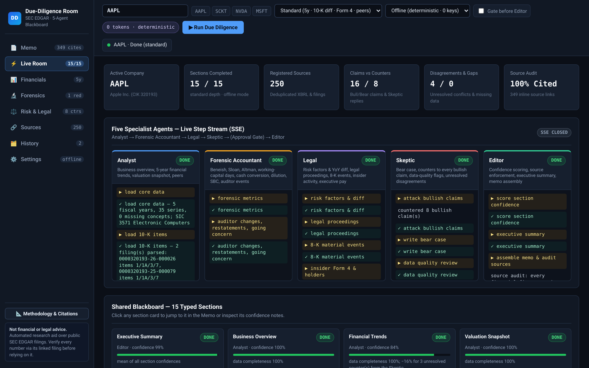
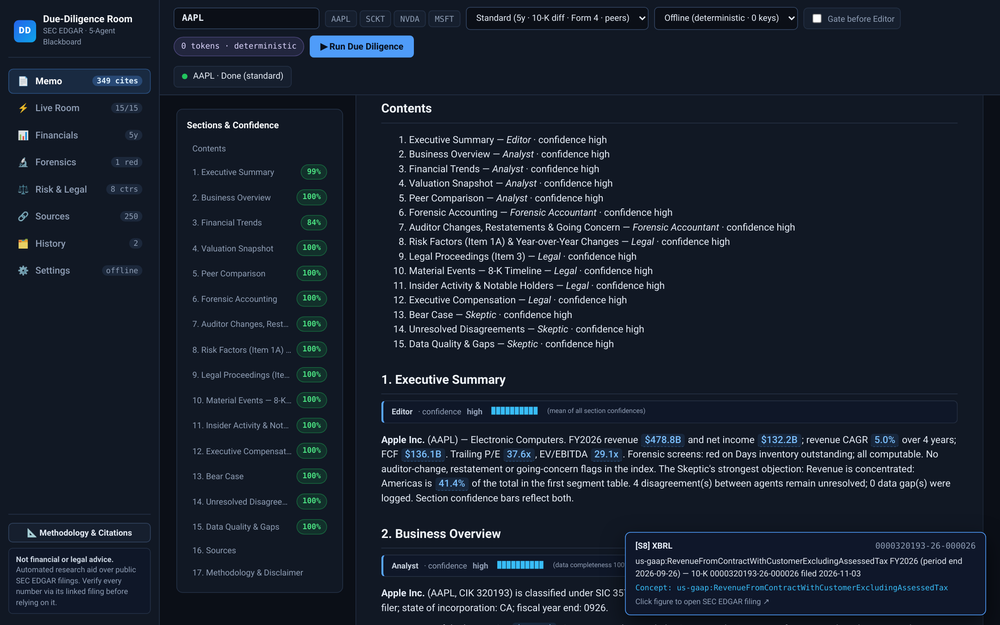
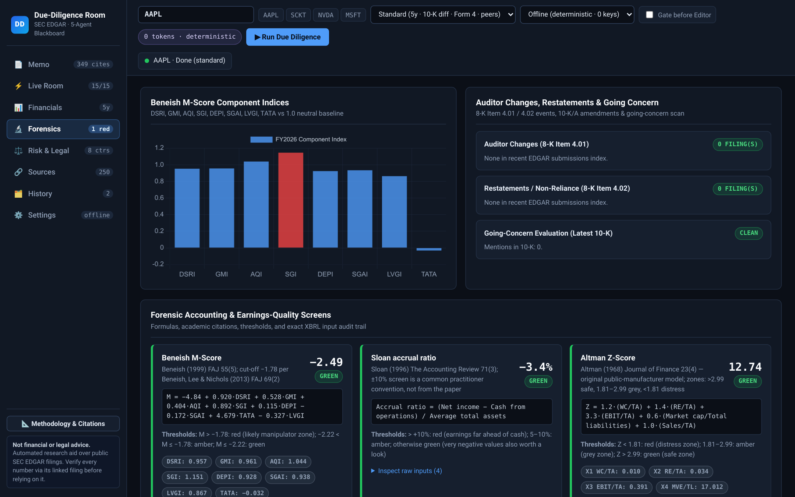
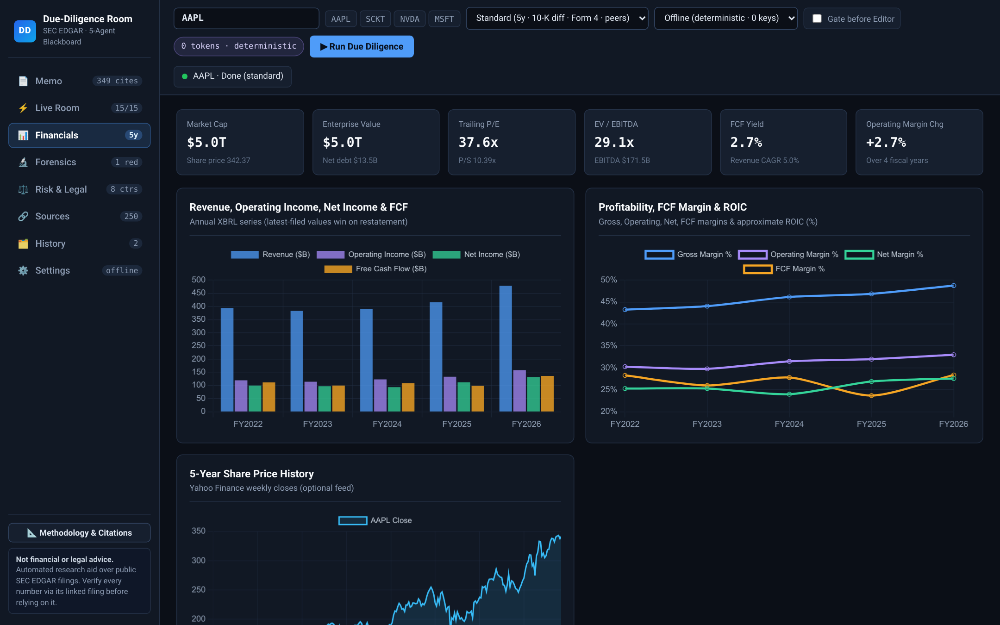
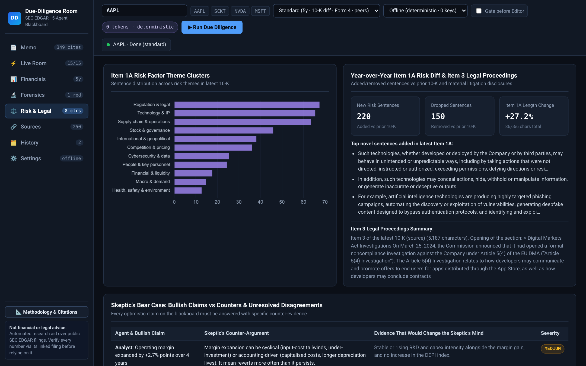
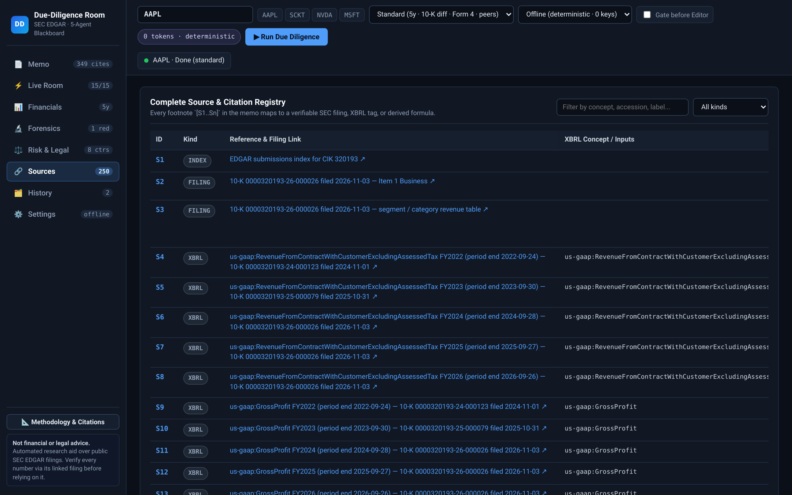

# Due-Diligence Room

**Due-Diligence Room** is a local-first, multi-agent SEC EDGAR investment research workstation. Enter a public company ticker or CIK and five specialist agents (**Analyst**, **Forensic Accountant**, **Legal**, **Skeptic**, and **Editor**) collaborate over a shared **Blackboard** to assemble a sourced investment committee memo where:

- **Every financial figure in prose or tables links to its primary source** (SEC EDGAR filing accession URL + XBRL concept tag, or the exact formula in `/methodology`), verified automatically by a regex source-enforcement audit (`0 unsourced figures`).
- **A mandatory Bear Case challenges every optimistic claim**, pairing each bullish thesis on the blackboard with a specific counter-argument and the concrete evidence that would change the Skeptic's mind.
- **Per-section confidence scores** reflect data completeness, unresolved cross-agent disagreements, and logged data gaps.
- **Works 100% offline-deterministically with zero API keys** by default, or optionally uses `gemini`, `anthropic`, `openai`, or local `ollama` to draft narrative prose behind a human approval gate.

---

## Screenshots

### 1. Live Room — 5 Specialist Agents Streaming Over SSE + Shared 15-Section Blackboard


### 2. Sourced Investment Memo — Inline XBRL Citations & Floating Source Inspector


### 3. Forensic Accounting — Beneish M-Score, Sloan Accruals, Altman Z & Auditor Events


<details>
<summary><strong>More Screenshots (Financials, Risk &amp; Legal, Sources Registry)</strong></summary>

#### Multi-Year XBRL Financials, Margins & Share Price History


#### Item 1A Risk Clusters, Year-over-Year 10-K Diff & Skeptic Counters


#### Complete Source & Citation Registry (`[S1..Sn]`)


</details>

---

## Quick Start (3 Commands)

```bash
git clone https://github.com/Sockshare/due-diligence-room.git
cd due-diligence-room
./run.sh
```

Then open **http://127.0.0.1:8112** in your browser.

`./run.sh` automatically creates a local `.venv` (using `uv` if available or `python3 -m venv`), installs pinned dependencies from `requirements.txt`, and launches the FastAPI server on `127.0.0.1:8112`.

### Command-Line Mode

To run a ticker directly from the terminal and write the Markdown memo to disk without starting the web server:

```bash
.venv/bin/python app.py --ticker AAPL --depth standard --provider offline --out AAPL_memo.md
```

---

## First-Use Walkthrough

1. **Identify yourself to SEC EDGAR (recommended):** Copy `.env.example` to `.env` and set `SEC_USER_AGENT="YourName your.email@example.com"`. SEC's fair-access policy asks automated clients to send a descriptive `User-Agent` header.
2. **Pick a ticker and depth:** In the top bar, type a ticker (e.g. `AAPL`, `SCKT`, `NVDA`, `MSFT`) or click one of the quick-pick chips, choose a depth (`quick`, `standard`, or `deep`), and click **▶ Run Due Diligence**.
3. **Watch the Live Room:** Switch to **Live Room** to watch the five agents (**Analyst**, **Forensic Accountant**, **Legal**, **Skeptic**, **Editor**) stream their tool executions over Server-Sent Events (SSE) and fill the 15 blackboard sections.
4. **Human Approval Gate (optional in offline mode, default in keyed LLM mode):** Check **Gate before Editor** in the top bar to pause the run after the first four agents complete. Inspect the blackboard claims, Skeptic counters, and token usage, then click **✓ Approve & Finalise** to let the Editor assemble the final memo.
5. **Audit every number:** In the **Memo** view, hover over any highlighted figure to inspect its XBRL concept (`us-gaap:...`), filing accession, and period, or click it to open the SEC EDGAR filing index. Export to **Markdown (`.md`)**, **PDF (`.pdf`)**, or **Print / Standalone HTML**.

---

## Configuration

All configuration is read from environment variables or a gitignored `.env` file. Every setting has a safe default so the application runs out-of-the-box with zero keys.

| Variable | Default | Description |
|---|---|---|
| `SEC_USER_AGENT` | `DueDiligenceRoom contact@example.com` | User-Agent sent on SEC EDGAR requests (set a real contact email per SEC fair-access policy). |
| `DD_HOST` | `127.0.0.1` | Host interface for the FastAPI server. |
| `DD_PORT` | `8112` | Port for the FastAPI server. |
| `DD_DATA_DIR` | `./data` | Local directory for SQLite (`dd_room.db`) and gzipped EDGAR HTTP cache (`data/cache/`). |
| `DD_LLM_PROVIDER` | `offline` | Default narrative mode: `offline`, `gemini`, `anthropic`, `openai`, or `ollama`. |
| `DD_LLM_MODEL` | *(provider default)* | Optional model override (`gemini-2.0-flash`, `claude-3-5-haiku-latest`, `gpt-4o-mini`, `llama3.1`). |
| `GEMINI_API_KEY` | *(unset)* | API key for Google Gemini (`generativelanguage.googleapis.com`). |
| `ANTHROPIC_API_KEY` | *(unset)* | API key for Anthropic (`api.anthropic.com`). |
| `OPENAI_API_KEY` | *(unset)* | API key for OpenAI (`api.openai.com`). |
| `OLLAMA_HOST` | *(unset)* | Base URL for local Ollama server (e.g., `http://127.0.0.1:11434`). |

---

## Architecture Summary

- **`agentkit/`**: Reusable multi-agent orchestration package providing a thread-safe `Blackboard` (typed sections, deduplicated source registry, bullish/bearish claims, Skeptic counters, disagreements, and data gaps), fault-tolerant `Agent` base class with `@tool` registry, `EventBus` (SSE stream + replay), `ApprovalGate`, and provider-agnostic `LLMClient`.
- **`dd_room/`**:
  - **Data layer (`sec.py`, `xbrl.py`, `htmlitems.py`, `filings.py`, `prices.py`)**: Token-bucket rate limiter (`8 req/s` default), gzipped disk cache with stale-on-error fallback, annual XBRL concept stitching with **"latest filed wins"** restatement tracking, largest-span 10-K item extractor (`Items 1, 1A, 3, 7`), Form 4 XML parser, and DEF 14A Summary Compensation Table parser.
  - **Analytics (`financials.py`, `forensics.py`)**: Multi-year trends, CAGR, FCF, ROIC, net debt, valuation multiples, **Beneish 8-variable M-Score** (Beneish 1999; Beneish, Lee & Nichols 2013), **Sloan accrual ratio** (Sloan 1996), **Altman Z-Score** (Altman 1968), DSO/DIO, cash conversion (`CFO/NI`), share dilution, and SBC/revenue.
  - **Five Specialist Agents (`dd_room/agents/`)**: `Analyst`, `ForensicAccountant`, `Legal`, `Skeptic`, and `Editor` coordinated by `Orchestrator`.
  - **Memo & Audit (`memo.py`, `pdf.py`)**: Markdown assembly, regex source enforcement (`audit_numbers`), HTML rendering, and pure-Python PDF generation.

See [docs/ARCHITECTURE.md](docs/ARCHITECTURE.md), [docs/METHODOLOGY.md](docs/METHODOLOGY.md), and [docs/USER_GUIDE.md](docs/USER_GUIDE.md) for full details.

---

## Data Sources & Licenses

- **SEC EDGAR APIs (`data.sec.gov`, `efts.sec.gov`, `www.sec.gov/Archives/edgar/`)**: Public domain U.S. government filings and XBRL facts. Accessed under SEC fair-access guidelines (`<= 10 requests/second` with descriptive `User-Agent`).
- **Yahoo Finance Chart Endpoint (`query1.finance.yahoo.com`)**: Optional best-effort daily price history for market cap, valuation multiples, and Altman $X_4$. If unreachable or unquoted, the app degrades cleanly and omits market-based multiples rather than guessing.
- **Chart.js v4.4.7**: Vendored locally at `dd_room/static/vendor/chart.umd.js` under the MIT License (`dd_room/static/vendor/CHART_JS_LICENSE`).

---

## Known Limitations

- **Non-dimensional XBRL only:** The SEC `companyfacts` endpoint does not expose dimensional (segment/geography) XBRL axes; segment revenue is extracted best-effort from HTML tables in the 10-K when present.
- **Standard US-GAAP taxonomy:** Filers that rely heavily on custom extension tags or IFRS tags without standard `us-gaap` equivalents will show explicit `n/a` gaps rather than guessed mappings.
- **SIC peer grouping:** Peer sets are discovered via 4-digit SIC code in EDGAR full-text search paired with XBRL calendar-year frames (`CYxxxx`), which is a coarse industry classification.
- **13F holder search:** Uses full-text company-name search across recent `13F-HR` filings and is indicative rather than a ranked ownership table.

---

## Disclaimer

**Research aid, not financial, investment, legal, or tax advice.** Due-Diligence Room is an automated software tool that parses public SEC filings and an unofficial price feed. Extracted figures, forensic scores, and narratives may contain parsing errors, omissions, or stale data. Nothing produced by this software is a recommendation to buy, sell, or hold any security. Always verify every figure against the linked primary SEC filing before relying on it.

## License

MIT License — Copyright (c) 2026 Julian Morrisette. See [LICENSE](LICENSE).
