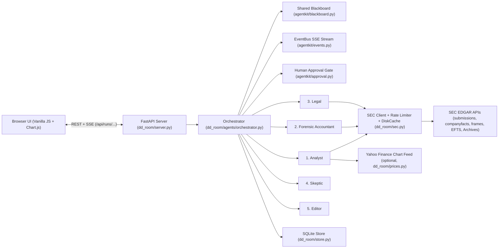

# Architecture — Due-Diligence Room

Due-Diligence Room is a local-first multi-agent SEC EDGAR investment research workstation. Five specialist agents collaborate over a typed **Blackboard** (`agentkit/blackboard.py`) to produce an institutional-style investment memo where every financial figure is linked to its primary SEC filing and XBRL concept, every optimistic claim is challenged by a dedicated **Skeptic**, and every section carries an explicit confidence score.

---

## 1. System Overview

---

## 2. Package Structure

### `agentkit/` — Reusable Multi-Agent Primitives

- **`blackboard.py`**: Thread-safe `Blackboard` holding:
  - `sections` (`dict[str, Section]`): 15 ordered sections (`executive_summary`, `business`, `financials`, `valuation`, `peers`, `forensics`, `audit_events`, `risk_factors`, `legal_proceedings`, `material_events`, `insiders`, `compensation`, `bear_case`, `disagreements`, `data_quality`).
  - `sources` (`dict[str, Source]`): Deduplicated registry (`S1..Sn`) keyed by `(kind, concept, accn, period)`. `Blackboard.cite(text, source_id)` emits `[text][Sn]`.
  - `claims` (`list[Claim]`): Typed claims (`bullish`, `bearish`, `neutral`) raised by agents with supporting source IDs and machine-readable tags.
  - `counters` (`list[dict]`): Counter-arguments attached by the Skeptic to every bullish claim, paired with explicit *"evidence that would change my mind"* and severity (`low`, `medium`, `high`).
  - `disagreements` & `gaps`: Cross-agent conflicts and missing concepts/filings that penalise section confidence.
- **`agent.py`**: Base `Agent` class and `@tool` decorator. Every tool invocation and step is timed, wrapped in fault-tolerant exception capture, and emitted to the `EventBus`.
- **`events.py`**: Thread-safe `EventBus` with history replay for Server-Sent Events (`SSE`).
- **`approval.py`**: `ApprovalGate` synchronization primitive. Pauses the worker thread after the first four agents complete so a human reviewer can inspect the blackboard and approve or reject before the `Editor` finalises the memo.
- **`llm.py`**: Provider-agnostic `LLMClient` over plain `urllib.request` HTTP (`gemini`, `anthropic`, `openai`, `ollama`, and zero-key `offline` deterministic mode).

### `dd_room/` — Domain Data, Analytics, Agents & Server

- **`sec.py`**: `SecClient` with configurable `User-Agent`, thread-safe `TokenBucket` rate limiter (default `8.0 req/s`, below SEC's `10 req/s` fair-access ceiling), and gzipped `DiskCache` (`data/cache/`) with stale-on-error fallback.
- **`xbrl.py`**: Extracts annual series from `companyfacts` JSON (`10-K`/`20-F`/`40-F` forms, `340–390` day durations for flows, instant values for balance-sheet items). Implements **"latest filed wins"** restatement resolution while preserving superseded values on each `Fact`.
- **`htmlitems.py`**: Forgiving `HTMLParser` text converter (stripping hidden `<ix:header>` blocks) and largest-span 10-K item extractor (`Item 1`, `Item 1A`, `Item 3`, `Item 7`) that automatically skips Table of Contents entries. Includes keyword risk-factor clustering, normalized sentence-level YoY diffing, going-concern regex detection, segment revenue table extraction, and `DEF 14A` Summary Compensation Table parsing.
- **`financials.py` & `forensics.py`**: Pure, deterministic math functions for multi-year trends, CAGR, FCF, ROIC, net debt, valuation multiples, Beneish 8-variable M-Score, Sloan accrual ratio, Altman Z-Score, DSO/DIO, cash conversion (`CFO/NI`), annualised share dilution, and SBC/revenue.
- **`filings.py` & `prices.py`**: 8-K timeline and material-item classifier (`Item 4.01` auditor change, `Item 4.02` restatement, `Item 5.02` officer turnover, etc.), Form 4 XML transaction parser, same-SIC peer discovery via EFTS + XBRL `frames`, 13F holder search, and optional Yahoo Finance price history.
- **`memo.py` & `pdf.py`**: Markdown memo assembler, `audit_numbers()` regex auditor that verifies every financial figure in prose carries a `[text][Sn]` citation, section confidence calculator, HTML renderer, and zero-dependency pure-Python PDF generator (`%PDF-1.4`).
- **`store.py` & `server.py`**: SQLite persistence (`data/dd_room.db`) for run history and user settings, plus the FastAPI application serving REST endpoints, SSE streams, and the vanilla JS single-page workstation (`dd_room/static/`).

---

## 3. Agent Execution Pipeline

1. **Analyst (`dd_room/agents/analyst.py`)**: Fetches submissions, XBRL `companyfacts`, 10-K HTML documents, and optional price history; populates `business`, `financials`, `valuation`, and `peers`; posts bullish/bearish claims on growth, margins, FCF, ROIC, balance sheet, and valuation.
2. **Forensic Accountant (`dd_room/agents/forensic.py`)**: Computes the 8 forensic screens with full component and XBRL input tables (`forensics`) and scans 8-K filings and 10-K text for auditor changes, restatements, and going-concern language (`audit_events`).
3. **Legal (`dd_room/agents/legal.py`)**: Clusters Item 1A risk factors and diffs them against the prior year's 10-K (`risk_factors`), extracts Item 3 litigation disclosures (`legal_proceedings`), builds the 24-month 8-K material event timeline (`material_events`), parses Form 4 XML insider trades and 13F holders (`insiders`), and parses the `DEF 14A` Summary Compensation Table (`compensation`).
4. **Skeptic (`dd_room/agents/skeptic.py`)**: Reads every bullish claim on the blackboard and attaches a structured counter-argument plus what evidence would change its mind (`bear_case`), audits XBRL seams/restatements/missing concepts (`data_quality`), and records cross-agent conflicts (`disagreements`).
5. **Approval Gate (`agentkit/approval.py`)**: Pauses execution when `auto_approve=False` so the user can review the populated blackboard and token usage before finalisation.
6. **Editor (`dd_room/agents/editor.py`)**: Computes per-section confidence scores from completeness, Skeptic counters, disagreements, and gaps; writes the balanced `executive_summary`; assembles the complete Markdown/HTML memo; and runs `memo.audit_numbers()` to verify zero uncited financial figures.
